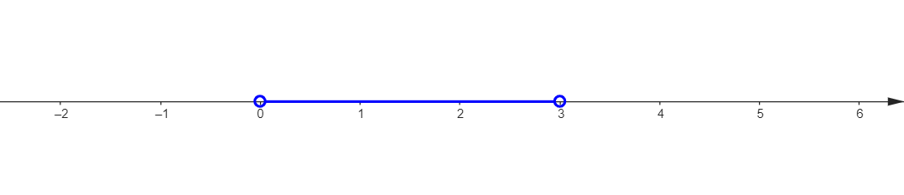
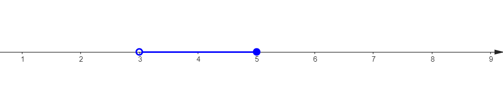
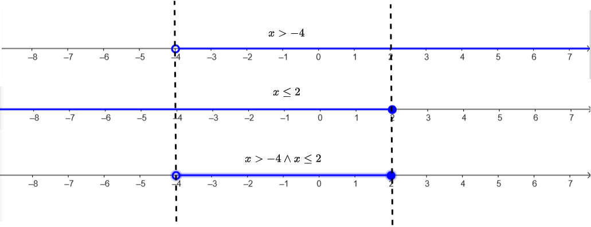

## UNITA' 1: Diseguaglianze ed intervalli

La scrittura $3 \gt 5$ è una **diseguaglianza** ed afferma una **relazione** tra due numeri, precisamente che il numero $3$ è maggiore del numero $5$: è chiaramente una affermazione falsa e si dice che il suo "***valore di verità***" è "Falso".

Analogamente "$\lt$" è il simbolo di "minore"; $1+2 \lt 5$ afferma che il risultato dell'espressione $1+2$ è minore del numero $5$: questa è chiaramente una affermazione vera Osserviamo che $1+2 \lt 3 \longrightarrow Falso.$

I simboli "$\le$" e "$\ge$" significano "minore o uguale" e "maggiore o uguale", per cui $3 \le 5 \longrightarrow Vero$  e  $3 \le 3 \longrightarrow Vero$ .

La scrittura $x < -2$ è invece una **disequazione**. Come per le equazioni, scrivere $x < -2$ significa scrivere qualcosa che di per sè non è ne vera ne falsa in quanto non contiene numeri che possono essere confrontati tra di loro, ma le disequazioni sono comunque importanti perché con esse possiamo porci un problema , che è quello di trovare i numeri che sostituiti alla lettera $x$​ rendono le relazioni vere.

Come per le equazioni, i numeri che rendono vera la disequazione $x < -2$ si chiamano "**soluzioni**" della disequazione. Come si vede facendo qualche prova, le soluzioni della disequazione sono tutti i numeri minori di $-2$, ad esempio $-3$, $-10$, $-100$, ma non $0$.

Sono un insieme infinito di numeri che indichiamo con la notazione insiemistica $\{x: x \lt -2\}$ che si legge "***l'insieme delle x tali che x è minore di meno due*** ". In particolare "$\{$" si legge "L'insieme delle... ":" si legge "tali che" .... e la parentesi chiusa finale non si legge.

Per indicare questo insieme si utilizza anche un'altra notazione, detta ad "**intervallo**": $(-\infty, -2)$. In questo modo si indicano tutti i numeri minori di $-2$ tranne il numero $-2$ che non fa parte dell'insieme. Se vogliamo includere anche il numero $-2$ scriviamo $(-\infty, -2]$, mentre il simbolo $-\infin$ sta ad indicare che non c'è un limite (inferiore) ai numeri negativi per appartenere all'insieme.

Se volessimo indicare tutti numeri minori di $-2$ ma maggiori di -$4$, scriveremmo $[-4, -2]$, intendendo che sia $-4$ che $-2$ fanno parte dell'insieme. Se vogliamo escludere $-4$ scriviamo $(-4, -2]$, e così via. Il numero $-4$ si chiama anche **limite inferiore** (o estremo inferiore) dell'intervallo ed il $-2$ **limite superiore** (o estremo superiore).

Gli intervalli si possono rappresentare anche graficamente, su una retta. Il grafico dell'intervallo $(0,3)$ è:

Nella simbologia grafica usata da GEOGEBRA, se il numero non fa parte dell'intervallo l'estremo del segmento è un puntino vuoto; se il numero invece fa parte dell'intervallo, l'estremo è un puntino pieno: l'intervallo $(3, 5]$ ha la figura riportata di seguito.

L'intervallo $[-4, 2]$ si dice **limitato inferiormente**, dal numero $-4$ e **limitato superiormente**, dal numero $2$, mentre $(-\infty, 2]$ è **illimitato inferiormente** e limitato superiormente. Analogamente $[-4, +\infty)$ è limitato inferiormente e **illimitato superiormente**.

 

### ESERCIZIO 1.1 - Disuguaglianze e disequazioni

a) Indicare quali delle seguenti disuguaglianze sono vere e quali false.  

1. $9 - 2 \lt 3$;
2. $5+8 \gt 19$;
3. $5 \cdot 2 \le 5 \cdot 7$;
4. $4 \cdot 8 \gt  2 \cdot 16$;
5. $8-2 \lt 14$;
6. $x + 1 \gt 0$;
7. $6 + 4 \le 10$

b) Trovare almeno due numeri che rendono vera ciascuna disequazione.

1.  $x + 1 \gt 0$;
2.  $x + 3 \le 4$;
3.  $2x-1 \lt 6$;
4.  ^*^  $x^2 + 2x -1 \ge 0$. 

### ESERCIZIO 1.2 - Soluzione di Disequazioni I

a) Nei casi riportati di seguito, determina quali tra i valori indicati nell'insieme è soluzione della disequazione associata.

1. $\{0, 1, -1\}$,   $x-2<6$;
2. $\{0, 3\}$,   $2x-1<3$;
3. $\{0, 5, 7\}$,   $3(x-5) - 6 < 0$;
4. $\{0, 5, 7\}$,   $5x - (6-x) \ge 0$.

b) Scrivi la disequazione corrispondente alle frasi riportate di seguito.

1. Insieme dei numeri minori o uguali ad $1$;
2. Insieme dei numeri non maggiori di $2$;
3. ^*^  Insieme dei numeri il cui doppio è minore di $3$;
4. Insieme dei numeri non maggiori di $-\dfrac{4}{13}$.

#### Laboratorio GEOGEBRA

a) Risolvi la prima parte del punto a.1) dell'esercizio con la sequenza di comandi GEOGEBRA riportata di seguito.

1. $d1(x) : x - 2 < 6$ &#9166; 
2. $\{d1(0), d1(1), d1(-1)\}$ &#9166;

### ESERCIZIO 1.3 - Intervalli e disequazioni elementari

a) In ciascuno dei casi riportati di seguito, determina se il numero appartiene all'intervallo.

1. $2\in [0; 3]$;      $\dfrac{1}{3} \in (-2; 2]$;
2. $2 \in [0; 3]$;      $\dfrac{2}{5} \in (\dfrac{2}{5}; 1)$;   
3. $-1 \in [-3; -2]$;
4. $-4 \in [-4; 0)$;
5. $0 \in (0; 1]$.

b) Rappresenta graficamente su una retta gli intervalli riportati di seguito.

1. $(0;1)$;   $[-1;1]$;
2. $(1;+\infty)$;   $(-\infty;5)$;
3. $[-1;0)$;   $[-3;+\infty)$;
4. $(-\infty; +\infty)$;   $(2;\dfrac{33}{5}])$.

c) Per ciascuno dei casi seguenti, scrivi la disequazione (elementare) o il sistema di disequazioni che ha come soluzioni l'intervallo indicato.

1.  $(-\infty;-5)$;     $[1;+\infty)$;
2.  $(1;+\infty)$;      $(-\infty;-\dfrac{50}{11})$;
3.  $[0; 3]$;      $(-2; 2]$;
4.  $(2; \dfrac{33}{5}]$;     $(\dfrac{2}{5}; 1)$;
5.  ^*^  Gli intervalli dei punti b.3) e b.4).

#### Laboratorio GEOGEBRA

Per il presente laboratorio, utilizzare la versione on-line di GEOGEBRA Classic all'indirizzo: https://www.geogebra.org/classic.

a) Risolvi la prima parte del punto a.1) dell'esercizio con la sequenza di comandi GEOGEBRA riportata di seguito.

1. $a : 0 \le x \and x \le 3$ &#9166; 
2. $a(2)$ &#9166;

Per rappresentare graficamente l'intervallo:

1. Dal "Menu Principale" seleziona "Cambia Calcolatrice" / "Grafici";
2. Dal menu della casella di input, seleziona "Impostazioni" e quindi dalla scheda "Stile" seleziona "Mostra sull'asse X".

b) Risolvi la restante parte del punto a.1) con sequenze di comandi GEOGEBRA analoghi a quelli precedenti. Ricorda di utilizzare altre etichette per indicare gli intervalli ($b, c$, etc.).

## UNITA' 2: Disequazioni di I grado con una incognita

La disequazione $x < -2$ è **elementare**, ossia è del tipo più semplice che si possa scrivere. 

Una disequazione solo di poco più complessa è, ad esempio, $x + 1 < -2$.

E' facile verificare provando, che per $x$ uguale a $0, 1, 2, ...$ la disequazione è sempre falsa. Per $x$ uguale a $-3, -4,  -5, ...$  la disequazione è sempre vera. Per trovare l'insieme delle soluzioni bisogna applicare lo stesso procedimento utilizzato per le equazioni, con le regole del **trasporto**, **semplificazione** e **moltiplicazione/divisione**:

a) $x + 1 < -2$;  con la regola del trasporto otteniamo la b):

b) $x < -2 -1$; con la regola della semplificazione otteniamo c):

c) $x < -3$.

La disequazione finale trovata è elementare e ci dice che l'insieme delle soluzioni è l'insieme dei numeri minori di $-2$.

Il procedimento per trovare l'insieme delle soluzioni di una disequazione è lo stesso che per le equazioni, con una differenza nella regola della  **moltiplicazione/divisione**: se moltiplichiamo per un numero negativo, la disuguaglianza cambia "segno" intendendo che "$<$" diventa "$>$", "$\le$" diventa "$\ge$"  e viceversa.

Ad esempio, le soluzioni della disequazione $-2x < 4$ si trovano con i passaggi seguenti:

a) $-2x \lt 4$;     con la regola della molt/div otteniamo b):

b) $-\dfrac{1}{2} \cdot \left( -2x  \right) \gt -\dfrac{1}{2} \cdot 4$$x < -2 -1$;    con la regola della semplificazione otteniamo c):

c) $x \lt -2$. 

### ESERCIZIO 2.1 - Soluzione di Disequazioni II

a) Per ciascuno dei casi seguenti, scrivi l'insieme delle soluzioni delle disequazioni come disequazione elementare, in forma insiemistica ed in forma di intervallo.

1. $x-1\ge 2$;
2. $7x-1\ge 2$;
3. $-x-1\le 2$;
4. $\dfrac{x}{5}-1\ge 2$;
5. $4x - 3 > 5x + 1$;
6. ^*^  $4[2(1 - x) -3] > 5x + 1$;

b) Per ciascuno dei casi seguenti, scrivi l'insieme delle soluzioni delle disequazioni in forma insiemistica e come intervallo.

1. $5(x-1) < 2(x-3)$;
2. ^*^  $3\left[(x+3)+\dfrac{1}{3}x\right]<7x$;
3. ^*^  $3(x-1)-1 < \dfrac{x-2}{3} - \left(x-\dfrac{x-1}{3}\right)$;
4. ^*^  $\dfrac{2+x}{3} \ge x + \dfrac{1}{2}$;
5.    $2x-5\lt 3+2x$;
6. $2(x+1) - 5x\ge 3x + 4(x+1)$.

## UNITA' 3: Sistemi di Disequazioni di I grado con una incognita

Fino ad ora abbiamo visto le disequazioni che dopo la loro risoluzione, arrivavano ad una disequazione elementare del tipo, ad esempio $x \le 4$, che ha come soluzione l'intervallo illimitato inferiormente $(-\infty, 4]$.

Tutti gli intervalli illimitati da una parte sono soluzioni di una disequazione elementare. Ma come esprimere con delle disequazioni gli intervalli limitati da entrambe le parti, come ad esempio $(-4, 2]$?

Questi intervalli devono in primo luogo essere essere scritti come intersezioni di intervalli illimitati, ad esempio:
$$
\begin{flalign}
\text{a)} &&  (-4, 2] = (-\infty, 2] \cap (-4, +\infty) && &
\end{flalign}
$$
 e successivamente espressi con **due disequazioni elementari**, una per intervallo, in **congiunzione** tra di loro:
$$
\begin{flalign}
\text{b)} &&  (-4, 2] = \{x: x \le 2 \and x \gt -4\} && &
\end{flalign}
$$
 Il simbolo $\and$ si legge "e" ed indica che un numero è nell'intervallo se e solo se è minore di $2$ e maggiore di $-4$.

 Due disequazioni che sono congiuntamente vere o "simultaneamente" vere si chiamano **sistema di disequazioni**; le due disequazioni elementari all'interno della b) sono quindi un sistema che si può scrivere 
$$
\left\{  
\begin{array}{c} 
x \le 2 \\  
x \gt 4 \\   
\end{array} 
\right.
$$
Per trovare in modo semplice le sue soluzioni possiamo rappresentare graficamente le soluzioni di tutte le disequazioni sulla  stessa figura:

Come si vede, il segmento blu in basso rappresenta i numeri che sono soluzione di entrambe le disequazioni e corrisponde alle soluzioni del sistema.
